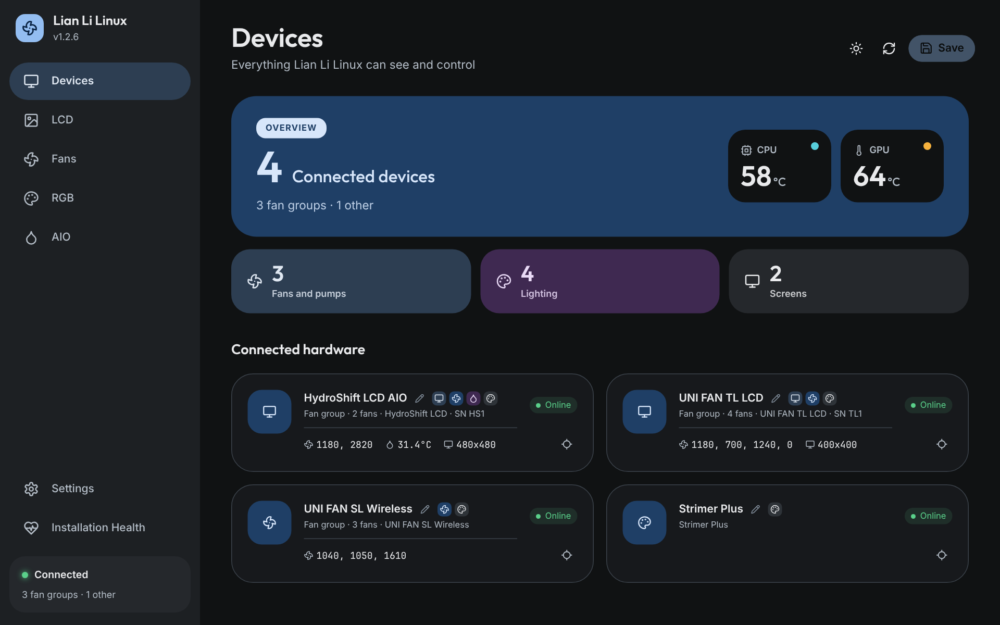
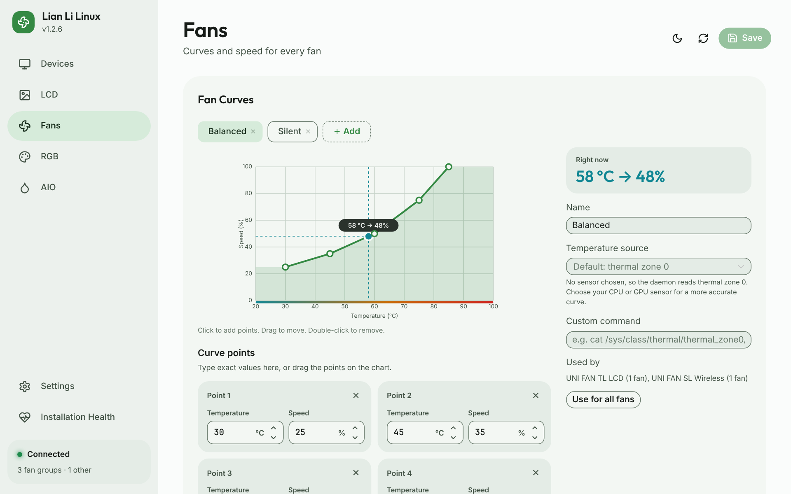
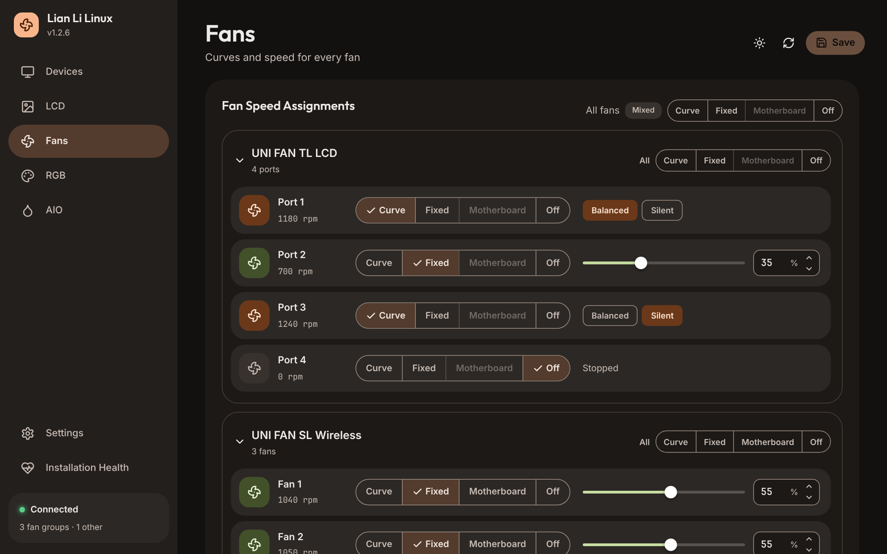
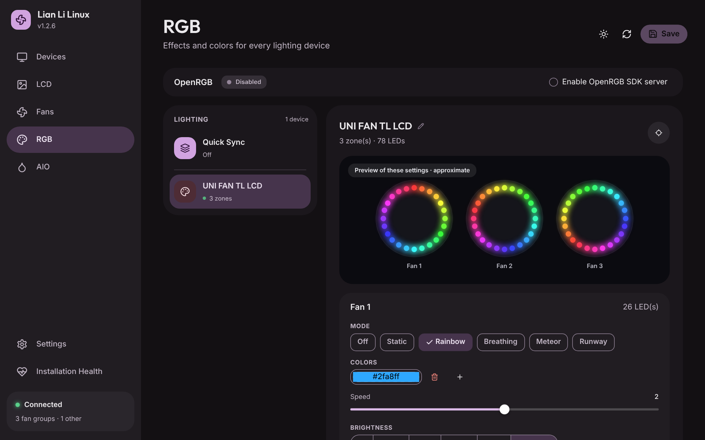
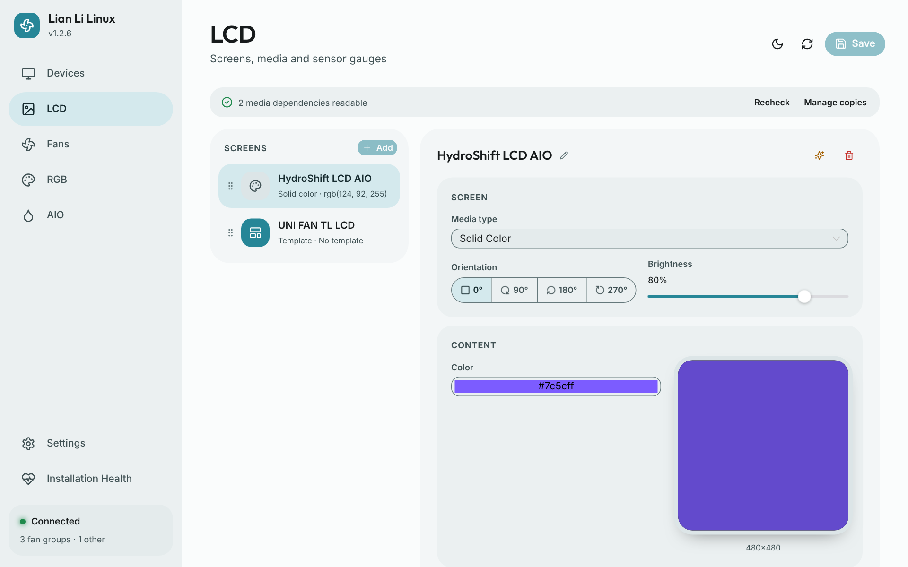
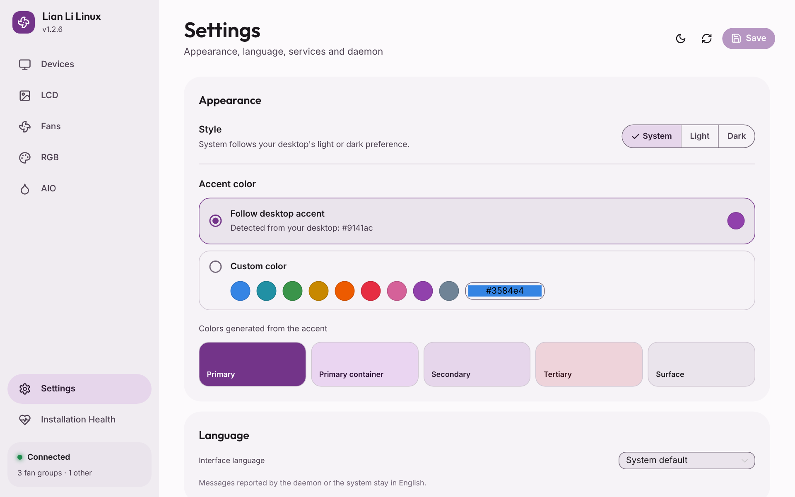

<p align="center">
  
</p>

<h1 align="center">Lian Li Linux</h1>

<p align="center">
  Open-source Linux replacement for L-Connect 3.<br>
  Fan speed control, RGB/LED effects, LCD streaming, and sensor gauges for all Lian Li devices.
</p>

<table>
  <tr>
    <td></td>
    <td></td>
  </tr>
  <tr>
    <td></td>
    <td></td>
  </tr>
  <tr>
    <td></td>
    <td></td>
  </tr>
</table>

The interface follows your desktop's accent color and light or dark preference. Screenshots use sample devices.

**Contents:** [What it does](#what-it-does) · [Quick start](#quick-start) ·
[Supported devices](#supported-devices) · [Software RGB effects](#software-rgb-effects) ·
[Installing](#installing) · [First launch](#first-launch) · [Cooling safety](#cooling-safety) ·
[Configuration](#configuration) · [Help and diagnostics](#help-and-diagnostics)

## What it does

- **Fan curves.** Drag points on a chart or type exact temperatures and speeds. Give each
  port or fan its own Curve, Fixed, Motherboard or Off mode.
- **AIO coolers.** Control pump and radiator fan speeds, and choose the sensor readouts,
  theme and colors shown on AIO screens.
- **LCD screens.** Show images, GIFs, videos, solid colors, sensor gauges or custom
  templates, with live previews, framing, brightness and rotation.
- **Lighting.** Hardware and software RGB effects per zone, presets, direct per-LED
  control and an optional OpenRGB SDK server.
- **Desktop mode.** Use supported screens as an extra monitor.
- **Alerts.** Switch every RGB device to an alert color when the CPU or GPU gets too hot,
  and re-apply saved lighting when wireless firmware resets it.
- **Fits your desktop.** The interface follows your desktop's accent color and light or
  dark preference, in English or Simplified Chinese.

## Quick start

1. Install the package for your distribution from [Installing](#installing).
2. Open **Lian Li Linux** and choose **User (at login)** or **System (at boot)**, then
   **Enable and start**. See [First launch](#first-launch).
3. Open **Installation Health** and fix anything it flags, then set up fans, lighting
   and screens. Select **Save** to apply changes.

## Supported Devices

**Tested** means confirmed on real hardware. **Not yet** means the device is
implemented from its protocol but not yet confirmed by a user.

### Wired controllers and AIOs (HID)

| Device | Fan Control | RGB | LCD | Pump | Tested |
|--------|:-----------:|:---:|:---:|:----:|:------:|
| UNI FAN SL / AL / SL Infinity / SL V2 / AL V2 | 4 groups | Yes | - | - | Yes |
| UNI FAN TL Controller | 4 ports | Yes | - | - | Yes |
| UNI FAN TL LCD | 4 ports | Yes | 400x400 | - | Yes |
| Galahad II Trinity AIO | Yes | Yes | - | Yes | Yes |
| HydroShift LCD AIO | Yes | Yes | 480x480 | Yes | Yes |
| Galahad II LCD / Vision AIO | Yes | Yes | 480x480 | Yes | Yes |
| Strimer Plus (wired) | - | Yes | - | - | Yes |

**Edge Hub Advanced** (`39b0:0101`) is read-only: its device card shows identity,
firmware version and three temperatures, and no fan, RGB or firmware commands are sent.
Its sensor accuracy is not yet confirmed on hardware.

### Wireless (via TX/RX dongle)

| Device | Fan Control | RGB | LCD | Pump | Tested |
|--------|:-----------:|:---:|:---:|:----:|:------:|
| UNI FAN TL V2 (LCD / LED) | Yes | Yes | 400x400 | - | Yes |
| UNI FAN SL V3 (LCD / LED) | Yes | Yes | 400x400 | - | Yes |
| UNI FAN SL-INF | Yes | Yes | - | - | Yes |
| UNI FAN CL / RL120 | Yes | Yes | - | - | Not yet |
| HydroShift II LCD-C (Wireless) | Yes | Yes | - | Yes | Yes |
| HydroShift II LCD-S (Wireless) | Yes | Yes | - | Yes | Yes |
| Strimer Plus Wireless | - | Yes | - | - | Yes |
| Lancool 217 Wireless | - | Yes | - | - | Not yet |
| Lancool V150 Wireless | Yes | Yes | - | - | Not yet |
| Universal Screen 8.8" Wireless | - | Yes | - | - | Not yet |

Both V1 (VID 0x0416) and V2 (VID 0x1A86) wireless dongles are supported. Binding devices is supported through the GUI, which reports command completion or failure. Wireless control requires both TX and RX dongles. Saved fan and lighting settings do not automatically bind an unbound group on startup. Use the GUI to bind it explicitly.

Wireless SL V3 fans support hardware motherboard PWM sync. Other wireless fans can follow a selected Linux PWM header; if that source is missing or becomes unreadable, they run at full speed until it returns.

> **Note:** Wireless devices with LCDs still need to be plugged in via USB to control the LCD. LCD cannot be controlled through wireless dongle alone.

When a device is connected both ways at once it shows once as a wireless group and the duplicate
wired entry is hidden, control and telemetry go over RF. Merging wired LCD fans into their wireless
group needs the V2 dongle, V1 dongles show both entries.

### USB LCD screens and AIOs

| Device | Fan Control | RGB | LCD | Pump | Tested |
|--------|:-----------:|:---:|:---:|:----:|:------:|
| HydroShift II LCD Circle | Yes | Yes | 480x480 | Yes | Yes |
| HydroShift II LCD Square | Yes | Yes | 480x480 | Yes | Yes |
| Lancool 207 Digital | - | - | 720x1472 | - | Yes |
| Universal Screen 8.8" | - | Yes | 480x1920 | - | Yes |
| Vision 9.2" | - | - | 464x1920 | - | Yes |
| TL Flex LCD | Yes | Yes | 400x400 | - | Yes |
| SL Infinity Flex LCD | Yes | Yes | 400x400 | - | Not yet |
| HydroShift II OLED Curve | - | Yes | 1080x2288 | Yes | Yes |

### Desktop Mode (Virtual Display)

HydroShift II, Lancool 207 Digital and Universal Screen 8.8" can extend your desktop.
Hyprland uses native headless monitors. Other sessions try Hermes-KMS first, then
EVDI. Desktop capture needs a logged-in graphical session, even with a system
daemon. These optional backends are not required for cooling, RGB or LCD playback.
See [desktop setup and requirements](docs/desktop-backends.md).

If you have tested a device marked **Not yet**, please
[report your results](https://github.com/sgtaziz/lian-li-linux/issues) with a diagnostic export.

## Software RGB effects

The RGB page offers software effects for supported wireless devices and verified wired frame-capable controllers. Choose an effect per zone, adjust colors, speed, brightness and direction, then save. Supported effects include Rainbow, Rainbow Morph, Breathing, Color Cycle, Runway, Meteor, Wave, Tide, Ping Pong and Twinkle, plus Static and Off. Direct mode edits individual LEDs; presets preserve either effects or direct colors.

Wireless devices and compatible wired receivers loop uploaded animations. Other supported wired LED controllers receive frames from the daemon, capped at 20 fps, and require the daemon to remain running. Large uploads may use fewer frames to fit device memory without changing the animation duration. Hardware effect controllers such as TL retain their existing modes.

## Installing

### Arch Linux (AUR)

Install the latest release:

```sh
yay -S lianli-linux
```

`lianli-linux-git` builds the latest `main` instead, for testing unreleased changes. The two packages conflict, so install only one.

To build the release package without an AUR helper:

```sh
git clone https://aur.archlinux.org/lianli-linux.git
cd lianli-linux
makepkg -si
```

### Fedora (COPR)

For immutable Fedora distributions such as Bazzite, use the
[recommended Distrobox installation](#distrobox-and-immutable-hosts) below.

Enable RPM Fusion Free for FFmpeg with libx264, then install the project package. Systems
that keep `ffmpeg-free` use `libavcodec-freeworld` from RPM Fusion instead of full FFmpeg:

```sh
sudo dnf install https://mirrors.rpmfusion.org/free/fedora/rpmfusion-free-release-$(rpm -E %fedora).noarch.rpm
sudo dnf copr enable sgtaziz/lian-li-linux
sudo dnf install lian-li-linux
```

### Debian and Ubuntu

Use the release artifact matching your distribution: Ubuntu 24.04, Ubuntu 26.04
or Debian 13, amd64. These packages are distribution-specific because their linked
libraries differ. See [download verification and installation](docs/debian-packages.md).

### NixOS

The repository is a flake. Import `nixosModules.default` and set
`services.lian-li-linux.enable = true`. See the [NixOS guide](docs/nixos.md).

### Distrobox and immutable hosts

**We strongly recommend Distrobox on immutable distributions such as Bazzite,
Fedora Silverblue and Kinoite.** It keeps the application and its dependencies
inside a Fedora container, avoiding application package layering and dependency
conflicts with the host image.

Follow the [Distrobox installation guide](docs/distrobox.md), including host USB
rules, the host bridge and user/system service setup. Complete the host setup
steps too: installing the package inside the box alone is not enough. Optional
desktop kernel modules still belong on the host.

[Native package layering on immutable Fedora](docs/immutable-host.md) is an
advanced alternative for users who specifically need a host installation. It
changes the host deployment and requires reboots. Prefer Distrobox for normal use.

### From Source

See [build dependencies and installation](docs/building-from-source.md).
`cargo build --release` builds the daemon, GUI, control helper and session helper,
including the frontend.

## First launch

Open **Lian Li Linux** after installation. **Installation Health** checks setup
and links to repair instructions. Fresh native installs leave both daemon services
stopped: choose **User (at login)** or **System (at boot)** and select **Enable and
start**. Only one mode can own the hardware.

Everything else lives in **Settings**:

- **Services** starts, stops or switches the daemon between user and system mode, and
  can copy your current settings and media to the new mode.
- **State backups** restores an earlier saved configuration, templates, RGB presets and profiles.
- **Managed media storage** and **Catalog storage** show the LCD media and downloaded
  template files the daemon keeps.

The system daemon needs access to every LCD asset, including images, video and fonts
referenced by templates.

- [Service setup, switching and recovery](docs/service-modes.md)
- [USB permissions and udev rules](docs/usb-permissions.md)
- [LCD assets and managed storage](docs/lcd-assets.md)
- [Startup image uploads](docs/startup-images.md)
- [Configuration and template backups](docs/state-backups.md)
- [OpenRGB and separate AL V2 regions](docs/openrgb.md)

## Cooling safety

Fans and pumps on a software curve need a working temperature reading. If readings
stop for five seconds, the daemon runs those fans and pumps at 100% until readings
return, then resumes the curve. At startup and after resume from sleep, it waits up to
three seconds for a first reading before falling back. Fans set to a fixed speed,
hardware-managed modes and motherboard sync are not affected.

## Configuration

The GUI saves changes through the daemon. User configuration lives in
`~/.config/lianli/`; system configuration lives in `/var/lib/lianli/`.

**Hardware video acceleration** is disabled by default. Enable it in Settings and
save to recreate active video streams without restarting the daemon. See
[hardware video](docs/hardware-video.md) for supported paths and diagnostics.

LCD cards also offer [pixel conditioning](docs/pixel-conditioning.md), with
cancellation and restoration of the previous display.

The GUI checks GitHub for a newer release at most once a day and links to its release
notes. Install updates through your package manager. Turn the check off in
**Settings → About**.

## Help and diagnostics

Start with [troubleshooting](docs/troubleshooting.md). Before opening an
[issue](https://github.com/sgtaziz/lian-li-linux/issues), export a diagnostic report
from **Installation Health**. The export requires daemon logs and includes logs
from the last daemon startup. Review the report before sharing it.

## Architecture

The Rust daemon owns hardware, cooling and media playback. The Tauri/Vue GUI
communicates with it over a Unix socket. `lianli-control` manages service ownership
and state transfer; `lianli-session` captures desktop outputs in the graphical
session.

## AI disclosure

Generative AI helped analyze USB captures and vendor software to work out device
protocols, and helped build the Vue frontend. All AI output is reviewed before it is
committed. Protocols for the maintainer's own devices were validated on real hardware;
others rely on community testing, so bug reports are welcome.

## License

MIT. See [LICENSE](LICENSE).

This project is not affiliated with Lian Li Industrial Co., Ltd.
Protocol information was obtained through reverse engineering for interoperability purposes.
